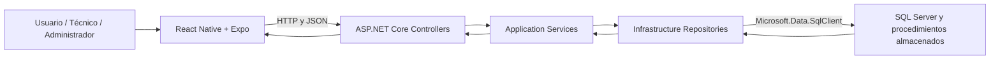

# GETICKETS

Sistema de mesa de ayuda para registrar tickets de soporte, asignarlos a técnicos y seguir su resolución. El repositorio contiene la API C#, la base de datos SQL Server y la aplicación Expo/React Native.

## Arquitectura



Una solicitud de ejemplo: el formulario móvil envía un `POST /api/Ticket`; `TicketController` recibe y valida el DTO; `TicketServices` adapta la petición; `TicketRepository` ejecuta `SP_NuevoTicket`; SQL Server crea el registro y devuelve su código; la API responde y la app actualiza la lista.

| Carpeta | Responsabilidad |
| --- | --- |
| `frontend/src/app` | Pantallas y navegación Expo Router. |
| `frontend/src/components` | Componentes compartidos, controles y estados de carga. |
| `frontend/src/context` | Sesión del usuario y preferencia de tema. |
| `frontend/src/lib/api.ts` | URL base, peticiones HTTP, conversión de respuestas y errores. |
| `GETICKETS/Presentation` | API HTTP, controllers, Swagger y registro de dependencias. |
| `GETICKETS/Aplication` | DTOs, interfaces y servicios que coordinan los casos de uso. |
| `GETICKETS/Domain` | Entidades principales del sistema. |
| `GETICKETS/Infraestructure` | Repositorios y conexión ADO.NET con SQL Server. |
| `database` | Esquema inicial, migraciones SQL y script de instalación. |
| `backend` | Servicio Node/Express auxiliar; ofrece el HTML 3D para el WebView móvil y también conserva rutas de prototipo con almacenamiento en memoria. No reemplaza la API C# conectada a SQL Server. |

Los nombres `Aplication` e `Infraestructure` conservan la escritura que ya usa la solución de Visual Studio.

## Base de datos y migraciones

La instalación principal crea las tablas en orden de claves foráneas, aplica las migraciones y registra cada versión en `dbo.Tbl_Migracion`. Requiere SQL Server 2016 SP1 o posterior, `sqlcmd` disponible en `PATH`, autenticación integrada de Windows y permisos para crear o actualizar la base y sus objetos.

Desde CMD o PowerShell, ubicado en la raíz del repositorio, ejecuta este comando para instalar o actualizar la base completa desde un solo archivo SQL. Cambia el servidor según el nombre que muestra SSMS:

```cmd
sqlcmd -S "(localdb)\MSSQLLocalDB" -E -b -i ".\database\GETICKETS-instalacion-completa.sql"
```

Por ejemplo, para SQL Express usa `-S ".\SQLEXPRESS"`. `-E` usa la cuenta de Windows y `-b` hace que `sqlcmd` falle al primer error. El script crea o actualiza la base `GETICKETS`, conserva los registros existentes y añade las cuentas de demostración si faltan.

`GETICKETS-instalacion-completa.sql` reúne los scripts versionados que aparecen abajo. `Install-GETICKETS.ps1` sigue disponible como alternativa PowerShell y ejecuta esas mismas migraciones por separado.

El orden es:

| Versión | Script | Qué prepara |
| --- | --- | --- |
| `000_base_schema` | `GETICKETS-base-schema.sql` | Base `GETICKETS`, tablas, relaciones, valores por defecto e índices. |
| `001_backend_procedures` | `GETICKETS-backend.sql` | Procedimientos almacenados llamados por la API C#. |
| `002_paridad` | `GETICKETS-paridad.sql` | Permisos y descripciones de roles, catálogos, puestos e historial; incluye datos de demostración. |
| `003_ticket_flow_fix` | `GETICKETS-ticket-flow-fix.sql` | Ajusta el listado y la resolución de tickets reabiertos. |

Los procedimientos usan `CREATE OR ALTER`; las migraciones comprueban las columnas, tablas e índices antes de crearlos. El instalador se puede volver a ejecutar y deja constancia de las versiones aplicadas en `dbo.Tbl_Migracion`.

`terminateONP.sql` es un script antiguo de referencia; no se usa en la instalación nueva. `frontend/sql/GETICKETS-frontend-contract.sql` es un contrato parcial y no se ejecuta después de las migraciones completas porque reemplaza procedimientos de la API.

Para demostración local, la migración crea estas cuentas si aún no existen:

| Rol | Correo | Contraseña |
| --- | --- | --- |
| Administrador | `admin@getickets.test` | `Admin123!` |
| Técnico | `tecnico@getickets.test` | `Tecnico123!` |
| Usuario | `demo@getickets.test` | `Usuario123!` |

Son credenciales de muestra para desarrollo y exposición; no se deben usar en producción.

## Ejecutar la API C#

Se requiere .NET 8. Configura la cadena de conexión para tu propia instancia de SQL Server. En PowerShell puedes definirla para la terminal actual; así cada compañero usa su instancia sin guardar la ruta personal en Git:

```powershell
$env:ConnectionStrings__default = "Data Source=.\SQLEXPRESS;Initial Catalog=GETICKETS;Integrated Security=True;Trust Server Certificate=True"
```

Desde la raíz:

```powershell
dotnet restore .\GETICKETS\Presentation\Presentation.csproj
dotnet run --project .\GETICKETS\Presentation\Presentation.csproj --launch-profile http
```

Swagger queda en `http://localhost:5116/swagger`. Ejecuta la API desde Visual Studio **o** desde la terminal; abrir las dos instancias a la vez ocupa el mismo puerto.

El perfil `http` escucha en `0.0.0.0:5116` para permitir pruebas desde la red local. En Expo Web, CORS permite los puertos de desarrollo configurados en `Program.cs`.

## Ejecutar React Native

Expo SDK 58 requiere Node.js 22.13 o posterior. Desde la raíz:

```powershell
Copy-Item .\frontend\.env.example .\frontend\.env.local
```

Edita `frontend/.env.local` y asigna `EXPO_PUBLIC_API_URL` según el dispositivo:

| Entorno | URL |
| --- | --- |
| Navegador en la misma computadora | `http://localhost:5116` |
| Emulador Android | `http://10.0.2.2:5116` |
| Teléfono físico | `http://<IP-LAN-DE-LA-COMPUTADORA>:5116` |

El mapa 3D nativo se carga en un WebView servido por el auxiliar Node en el puerto 3000. Su URL también se configura por separado: en navegador o simulador iOS usa `localhost`; en emulador Android usa `10.0.2.2`; en teléfono físico usa la IP LAN de la computadora. Ajusta `EXPO_PUBLIC_OFFICE_3D_URL` en `.env.local` según el dispositivo y, si vas a usar el mapa, inicia el servicio auxiliar en otra terminal:

```powershell
cd .\backend
npm ci
npm run dev
```

Después inicia Expo en otra terminal:

```powershell
cd .\frontend
npm ci
npx expo start
```

Para un teléfono físico, ambos dispositivos deben estar en la misma red y Windows Firewall debe permitir los puertos 5116 y 3000 si se usa el mapa 3D. `.env.local` es local y no se sube a GitHub.

## Librerías principales

| Proyecto | Librerías | Uso |
| --- | --- | --- |
| React Native | Expo 58, React Native 0.88, React 19, TypeScript 6 | Plataforma móvil y tipado. |
| Navegación | Expo Router, React Navigation, `react-native-screens`, `react-native-safe-area-context`, `react-native-pager-view`, `react-native-tab-view` | Rutas, pestañas deslizables y áreas seguras. |
| Interfaz | `lucide-react-native`, `react-native-svg`, Public Sans, Bricolage Grotesque e IBM Plex Mono | Iconos, gráficos vectoriales y tipografía. |
| Animación | React Native `Animated`, `react-native-reanimated`, `react-native-worklets` | Transiciones y movimiento de la interfaz. |
| Sesión y perfil | `@react-native-async-storage/async-storage`, `expo-image-picker`, `expo-image-manipulator` | Guardar sesión/preferencias y seleccionar/ajustar foto de perfil. |
| Oficina 3D | Three.js, `@react-three/fiber`, `@react-three/drei`, `expo-gl`, `react-native-webview` | Escena 3D nativa y vista web del mapa en móvil. |
| API C# | ASP.NET Core .NET 8, `Microsoft.Data.SqlClient` 7.1.2, Swashbuckle 6.6.2 | Endpoints REST, conexión SQL y Swagger. |
| Servicio Node auxiliar | Express 4, CORS, Three.js; TypeScript y `tsx` en desarrollo | Servidor auxiliar para el prototipo 3D. Sus rutas de prototipo usan memoria. |

La API C# usa ADO.NET y procedimientos almacenados; no usa Entity Framework ni Dapper. Por eso los cambios de base de datos se escriben como migraciones SQL explícitas en `database/`. `package-lock.json` fija las dependencias de Node para `npm ci`.

## Cómo explicar el proyecto en la exposición

1. **La pantalla móvil** reúne datos y envía solicitudes HTTP en JSON; no abre una conexión directa a SQL Server.
2. **El controller C#** recibe la ruta HTTP y sus parámetros. El servicio coordina el caso de uso, y el repositorio llama el procedimiento almacenado con parámetros mediante `Microsoft.Data.SqlClient`.
3. **SQL Server** mantiene los datos relacionados en tablas separadas. Por ejemplo, el ticket guarda IDs de usuario, categoría, prioridad y estado; el seguimiento y la auditoría registran los cambios del caso.
4. **Las migraciones** preparan tablas y procedimientos en un orden conocido. Cada script tiene una versión en `dbo.Tbl_Migracion`; el instalador llama `sqlcmd` y detiene la secuencia si una migración falla.
5. **La separación por capas** permite explicar cada responsabilidad: `Presentation` recibe HTTP, `Aplication` contiene servicios y DTOs, `Domain` representa entidades, e `Infraestructure` implementa repositorios y conexión SQL.

Una forma sencilla de presentar el flujo es: “El usuario reporta un ticket desde React Native. La API valida y coordina la operación; el repositorio llama un procedimiento almacenado. SQL Server guarda el ticket y su actividad. Luego la API devuelve la respuesta y la app actualiza la pantalla”.

## Preparación para trabajar en equipo

Cada compañero clona la rama publicada y puede crear una copia local con el mismo esquema y datos iniciales:

```powershell
git clone --branch frontend https://github.com/Turkudito69/PROYECTO-GETICKETS.git
cd PROYECTO-GETICKETS
```

Luego instala SQL Server y `sqlcmd` y ejecuta el comando anterior con su servidor. Eso no copia tickets ni usuarios reales que ya existan en otra computadora. Para compartir exactamente los mismos registros, deben conectarse a una única instancia SQL Server accesible por la red o compartir y restaurar un respaldo `.bak`. GitHub contiene el código y las migraciones, no una instancia compartida de SQL Server ni el archivo `.env.local`.

## Guion corto para la exposición

> “La app está separada de la API. React Native se ocupa de las pantallas; la API recibe las peticiones HTTP y sus servicios coordinan los casos de uso. Los repositorios conectan con SQL Server mediante procedimientos almacenados. Así podemos cambiar la interfaz sin reescribir las consultas y mantener las operaciones del ticket centralizadas en la base de datos.”

El flujo implementado es `Abierto → Asignado → En Proceso → Resuelto → Completado`. La API actual no emite token de autenticación ni aplica autorización por rol en el servidor; los controles de rol en la app organizan la interfaz, pero todavía no constituyen seguridad del backend.
